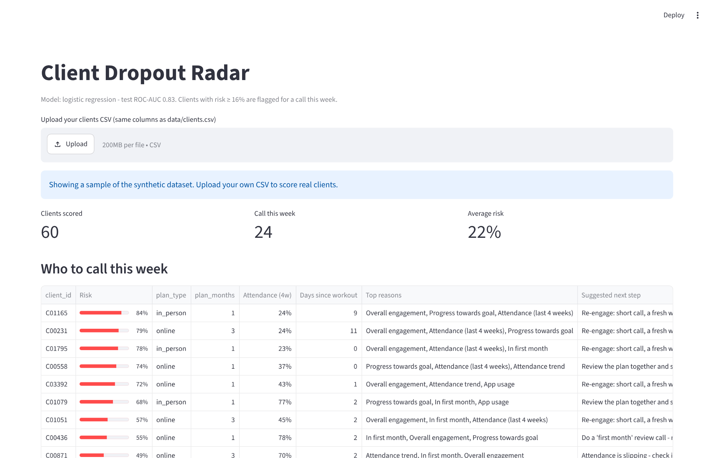
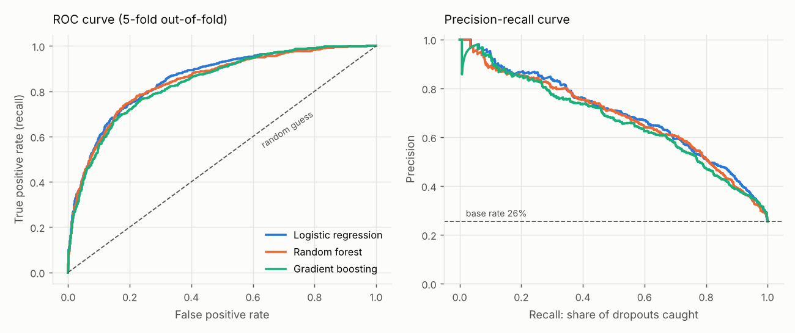
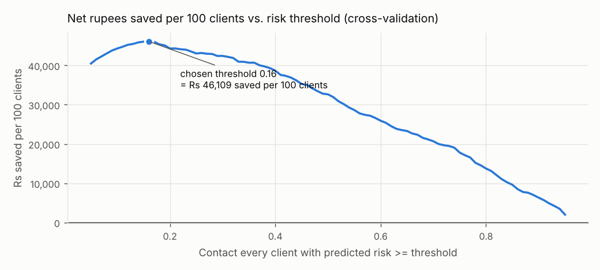
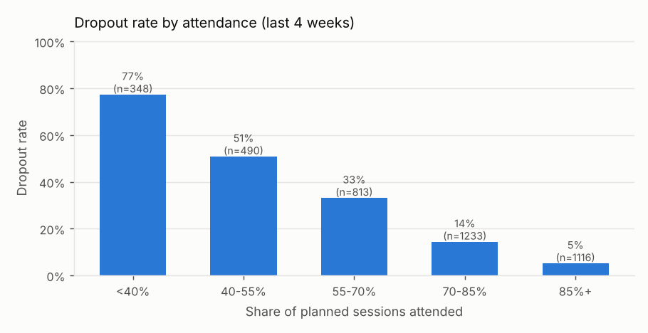
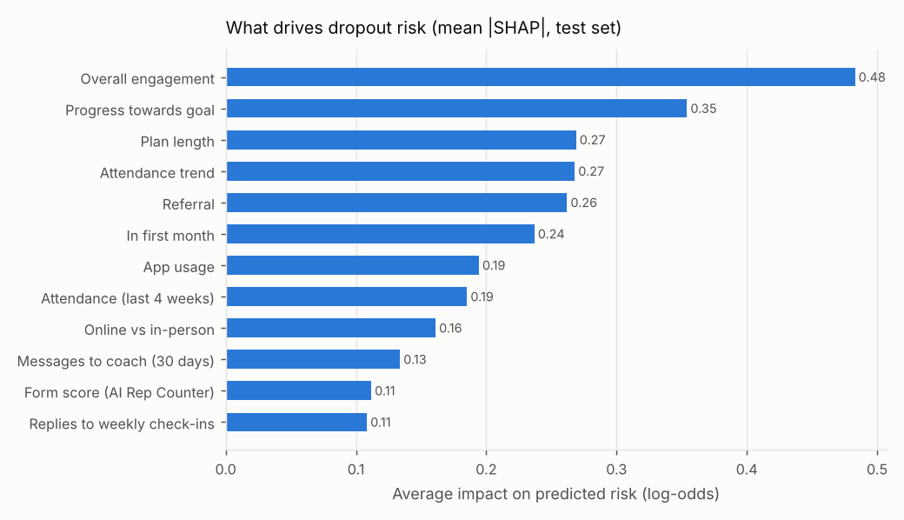
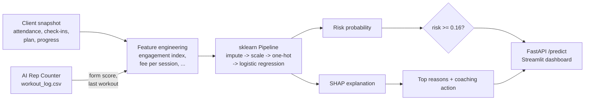

# Client Dropout Predictor

[](https://github.com/coach-who-codes/client-dropout-predictor/actions/workflows/ci.yml)


**Predicts which personal-training clients will quit in the next 30 days, explains *why* with SHAP, and tells the coach what to do about it - served as a REST API and a dashboard.**

<p align="center"></p>

## Why I built this

I'm a personal trainer. The client I lose is rarely the one who complains - it's the one who goes quiet: misses a session, stops replying to check-ins, and is gone by the end of the month. A 10-minute call at the right time usually saves them. This project finds those clients early.

It's the second half of a pair: my [**AI Rep Counter**](https://github.com/coach-who-codes/ai-rep-counter) logs every workout with a form score, and those logs become features here (`avg_form_score`, `days_since_last_workout`).

## Results (held-out test set, 800 clients)

| | |
|---|---|
| **ROC-AUC** | **0.83** |
| PR-AUC | 0.65 (base rate 0.26) |
| Recall at the chosen threshold | **83%** of dropouts caught |
| Precision | 43% (1 in 2.3 calls goes to a real at-risk client) |
| Brier score | 0.138 (probabilities are calibrated) |
| **Business value** | **~Rs 42,000 saved per 100 clients** under the cost assumptions below |

Cross-validated model comparison (5-fold, training set only):

| Model | ROC-AUC | PR-AUC | Brier | Rs saved / 100 clients |
|---|---|---|---|---|
| **Logistic regression** | **0.854** | **0.695** | **0.126** | **46,109** |
| Random forest | 0.845 | 0.683 | 0.128 | 44,533 |
| Gradient boosting | 0.837 | 0.668 | 0.135 | 43,333 |

**The simple baseline won.** The signal is mostly additive (lower attendance -> higher risk), so the ensembles' extra flexibility mostly fit noise. I shipped logistic regression: same accuracy, faster, and every prediction is explainable to a non-technical coach.

<p align="center"></p>

## The threshold is a business decision, not 0.5

A flagged client gets a personal call + one free session.

```
catching a real dropout = 35% saved x Rs 9,000 lost fees - Rs 500 action cost = Rs 2,650
a false alarm           = Rs 500
```

Missing a dropout costs 5x more than an extra call, so the threshold that maximises savings (chosen on out-of-fold predictions) is **0.16**, not 0.5. It lands exactly on the break-even probability 500 / (0.35 x 9,000) = 0.16 - a sanity check that the model's probabilities are calibrated. That's also why I **didn't** use `class_weight="balanced"`: it inflates probabilities; moving the threshold handles the imbalance instead.

<p align="center"></p>

## What drives dropout

<p align="center">
  
  
</p>

Every prediction comes with its top reasons and an action, e.g. from the API:

```json
{
  "client_id": "C00042",
  "dropout_probability": 0.9378,
  "risk_level": "high",
  "contact_this_week": true,
  "top_reasons": [
    {"label": "Overall engagement",    "value": 0.37, "impact": 1.18, "action": "Re-engage: short call, a fresh weekly target, celebrate a small win."},
    {"label": "Progress towards goal", "value": 12.0, "impact": 0.94, "action": "Review the plan together and set a small 2-week goal they can hit."},
    {"label": "In first month",        "value": 1,    "impact": 0.42, "action": "Do a 'first month' review call - month one is when most people quit."}
  ]
}
```

## How it works



- **No leakage:** all preprocessing lives inside the `Pipeline`; model *and* threshold are selected with out-of-fold predictions; the test set is scored once.
- **No training/serving skew:** feature engineering is stateless, and a test checks a single API request gets the exact same features as the same client in a training batch.
- **Explanations you can trust:** a test verifies SHAP's additivity (base value + contributions = the model's log-odds).

Full reasoning in [docs/DESIGN.md](docs/DESIGN.md) and the [notebook](notebooks/01_eda_and_modeling.ipynb).

## Quickstart

```bash
git clone https://github.com/coach-who-codes/client-dropout-predictor.git
cd client-dropout-predictor
python -m venv .venv && source .venv/bin/activate   # Windows: .venv\Scripts\activate
pip install -r requirements-dev.txt

PYTHONPATH=src python -m dropout.train     # compare models, pick threshold, save model + reports
pytest -q                                   # 28 tests
```

**API** (interactive docs at http://127.0.0.1:8000/docs):

```bash
PYTHONPATH=src uvicorn api.main:app --reload
curl -X POST localhost:8000/predict -H "content-type: application/json" -d '{
  "age": 29, "gender": "M", "goal": "fat_loss", "plan_type": "online", "plan_months": 1,
  "monthly_fee_inr": 4000, "tenure_weeks": 3, "sessions_planned_per_week": 4,
  "attendance_rate_4w": 0.45, "attendance_trend": -0.2, "days_since_last_workout": 9,
  "checkin_response_rate": 0.3, "weight_progress_pct": 12}'
```

**Docker:**

```bash
docker build -t dropout-api . && docker run -p 8000:8000 dropout-api
```

**Coach dashboard:**

```bash
streamlit run app/dashboard.py
```

## About the data

Real client data is private, so `src/dropout/data.py` generates **4,000 synthetic clients** from patterns I see as a coach (a hidden motivation level drives attendance and replies; month one is riskiest; referred and in-person clients stay longer; slow results on an expensive plan push people out). Part of motivation is deliberately unobservable, so the problem isn't trivially solvable. Swap in a real export with the same columns and everything else runs unchanged.

## Project structure

```
src/dropout/
  config.py     feature lists + business cost assumptions
  data.py       synthetic client generator
  features.py   engineered features + AI Rep Counter log aggregation
  model.py      pipelines, CV, cost-based threshold, metrics
  explain.py    SHAP per client -> readable reasons -> coaching actions
  plots.py      report figures
  train.py      end-to-end training script
api/main.py         FastAPI service (validated input, single + batch scoring)
app/dashboard.py    Streamlit "who to call this week" dashboard
notebooks/          EDA + modelling walkthrough (executed)
reports/            metrics.json + figures
tests/              data, features, model, SHAP and API tests
```

## Next steps

- Re-validate on my real client history.
- Survival model (time-to-dropout) to also predict *when*.
- Capacity-aware ranking ("I can make 10 calls this week") by expected savings.
- Drift monitoring and monthly retraining.

## Author

**Amit Dubey** - personal trainer turned ML engineer, building AI for the problems I see on the gym floor.
GitHub [@coach-who-codes](https://github.com/coach-who-codes) - Instagram [@muscleaddict_amit](https://instagram.com/muscleaddict_amit)
